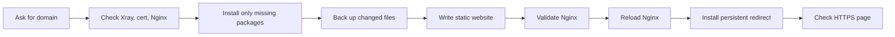

# XHTTP Web Setup

Make an ordinary HTTPS website work beside an existing Xray VLESS + XHTTP server.

| Part | Job |
|---|---|
| Xray / x-ui | Keeps the existing VLESS + XHTTP listener on TCP `443` |
| Nginx | Serves the normal website on local TCP `8443` |
| Firewall redirect | Sends public TCP `443` traffic to Nginx |
| Static site | Gives visitors a small, responsive portal |

The installer does not change Xray users, UUIDs, routes, or transport settings. It does not collect website passwords.

## Quick install

Download a reviewed release, inspect it, then run it as root:

```bash
curl --fail --location --proto '=https' --tlsv1.2 \
  'https://github.com/jackh0006/XHTTP-WEB-Setup/releases/latest/download/xhttp-web-setup.sh' \
  --output /tmp/xhttp-web-setup.sh
less /tmp/xhttp-web-setup.sh
sudo bash /tmp/xhttp-web-setup.sh
```

The script asks for the website domain and checks the active Xray configuration and certificate before making changes.

## What happens



If a check fails, the installer stops. If Nginx cannot validate or reload, it restores the previous Nginx files.

## Requirements

- Ubuntu or Debian with `systemd`, `apt`, and root access.
- An active `x-ui` service.
- Exactly one VLESS + XHTTP + TLS inbound on TCP `443`.
- A certificate in that Xray inbound that covers the requested domain.
- DNS records pointing the domain at the server.

The script installs missing command-line prerequisites with apt. It never installs or upgrades x-ui or Xray.

## Safety

- ✅ Backs up every file it overwrites under `/root/cloudf-web-setup-backup-*`.
- ✅ Uses `nginx -t` before reload.
- ✅ Checks the staged HTTPS page before enabling the public redirect.
- ✅ Does not restart or reconfigure Xray.
- ✅ Rejects invalid domains, unsafe XHTTP paths, missing certificates, and certificate mismatches.
- ❌ Does not move money, access wallets, or read repository secrets.

## Rollback

Find the latest backup:

```bash
sudo find /root -maxdepth 1 -type d -name 'cloudf-web-setup-backup-*' -printf '%T@ %p\n' | sort -nr | head
```

Review the backup before restoring files. Stop the redirect with:

```bash
sudo systemctl stop cloudf-https-redirect.service
sudo systemctl disable cloudf-https-redirect.service
```

## Tests

```bash
./tests/test.sh
```

## License

Apache-2.0. See [LICENSE](LICENSE).
